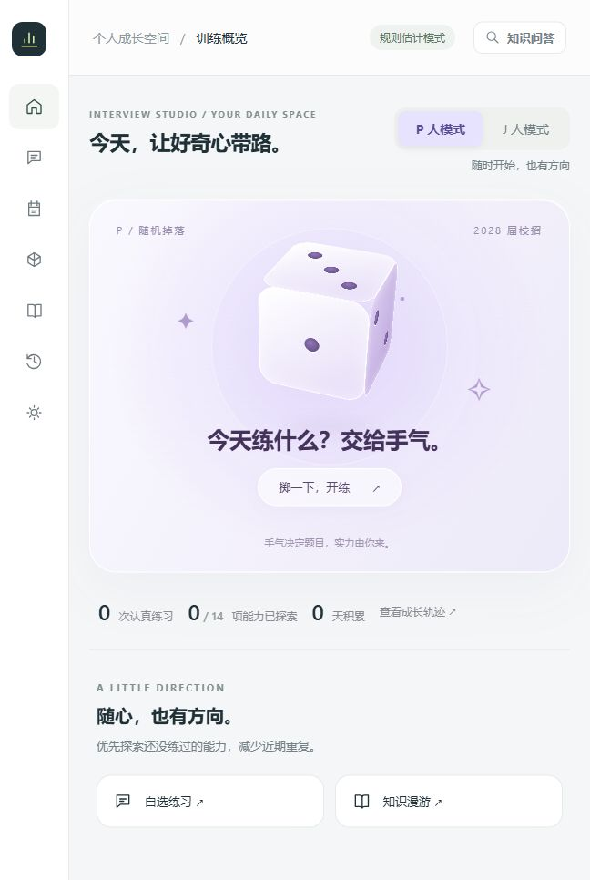
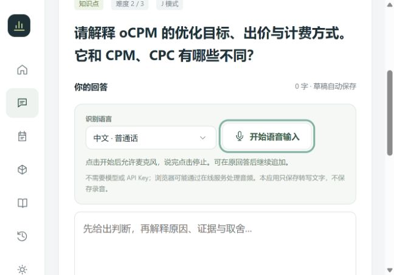

# 候场 · 2028 届产品经理面试训练室

一个为 2028 届校招准备的本地优先模拟面试 Agent，聚焦广告策略产品、商业化系统与广告 AI 产品。它把“随便刷题”变成一套可追踪的训练闭环：能力库决定练什么，题库负责怎么问，回答证据更新掌握度，历史记录再影响下一次选题。

> 当前仓库默认使用匿名演示经历和精选公开知识，可直接体验完整流程。作者的个人简历、飞书资料、本地数据库、模型密钥与训练历史均未上传。



## 为什么做这个产品

面试准备通常散落在文档、面经、简历和临时复盘里，常见问题是：不知道今天练什么、同一题反复背诵、回答质量难以量化、练习记录没有反哺后续计划。

候场把这些内容组织成四层：

```text
知识库（专业知识 / 面经 / 个人经历 / 练习记录）
             ↓ 检索与证据
能力库（广告 + AI / 产品 / 面试表达 / 英文）
             ↓ 映射
题库（情景题 / 简历面 / 行为面 / 知识点）
             ↓ 练习
动态画像与下一次训练计划
```

产品面向个人长期训练，而不是一次性的聊天问答。评分只是一种训练信号，不代表真实面试通过率。

## 核心体验

### P 人模式：把今天交给手气

掷骰子后，系统根据尚未覆盖的能力、当前掌握度和近期重复情况加权抽题。题目以动画弹层出现，适合每天快速开始、不想先制定计划的练习。

### J 人模式：把目标拆成今天

根据每天可投入时间生成稳定的日计划，同时展示完成项、待练能力和完整训练进度。手动重排不会覆盖已完成或正在回答的题目。

### 两轮模拟面试

每次练习包含主问题、针对性追问与结构化反馈。看过提示会降低这次证据权重；看过参考答案则不更新能力画像，避免“照着答案念”被当成真实掌握。

### 动态能力画像

当前覆盖 14 项能力：

- 专业能力：广告竞价与计费、投放效果诊断、归因与回传、实验与增量、RAG、广告 AI 产品
- 产品能力：问题定义、指标与取舍、推进协作、项目复盘
- 面试能力：英文水平、表达结构、回答完整性、表达简洁性

能力分不是静态自评。系统会结合评分引擎、是否使用辅助、同题重复次数和历史证据动态更新，并显示证据置信度。

### 简历深挖

公开版包含 3 张匿名演示经历卡和 6 道专属追问，覆盖广告冷启动、广告异动诊断 Agent 与素材 Copilot。每张卡片都把事实、待核实结论和追问分开，演示如何避免把团队结果或预期收益讲成个人已验证成果。

把自己的 `resume_cards.json` 放进 `data/private/` 后，系统会优先使用个人经历；该目录已被 Git 忽略。

### 英文练习与术语增强

内置英文自我介绍、项目取舍和广告效果诊断题。回答中文时，可以调用模型生成英文表达；系统会用本地术语表补充 CPA、ROAS、attribution、incrementality、RAG 等专业词，且校验数字是否被翻译改变。由翻译辅助完成的回答不会被当作独立英文能力证据。

### 语音输入

回答区支持中文普通话和英文语音输入，实时显示识别中的文本，并把最终结果追加到回答框。



语音识别使用浏览器 Web Speech API：Chrome/Edge 支持较好，需要麦克风权限；浏览器可能通过在线服务处理音频。本应用只保存识别后的文字，不保存音频文件。浏览器不支持时仍可正常键盘输入。

### 知识库与问答

首次启动会自动写入：

- Google Ads、IAB Tech Lab、巨量引擎等公开资料的人工整理卡片
- 广告竞价、质量、智能出价、转化回传、增量实验、生成式素材与 Agentic Advertising 等主题
- 匿名演示经历
- 广告与 AI 英文术语表

资料保留标题、发布方、链接、类别和审核状态。可以在界面继续补充专业资料、面经和个人经历，也可以通过 API 检索。当前检索基于 SQLite FTS，适合这版轻量知识库；是否升级向量召回和 reranker，应先根据真实查询集评估。

## 立即体验

### 方式一：本地运行（推荐）

要求：Node.js 24 或更高版本，Chrome/Edge。

```bash
git clone https://github.com/leah374/Interview-Training-Room-for-28Fall-PM.git
cd Interview-Training-Room-for-28Fall-PM
npm start
```

浏览器打开 <http://127.0.0.1:8765>。

Windows 也可以直接双击 `start.cmd`，停止后台服务时双击 `stop.cmd`。项目没有第三方 npm 依赖，不需要先执行 `npm install`。

首次启动会自动创建 `data/interview.sqlite` 并填充公开演示资料。数据库只在本机生成，已被 `.gitignore` 排除。

### 方式二：GitHub Codespaces

仓库包含 Dev Container 配置。点击仓库页面的 **Code → Codespaces → Create codespace**，环境创建完成后在终端执行：

```bash
npm start
```

端口 `8765` 会自动转发并打开页面。为了让语音输入获得麦克风权限，请在浏览器允许该 Codespaces 页面访问麦克风。

## 模型接入（可选）

不开模型也能体验选题、计划、两轮练习、规则反馈、能力更新、知识检索、语音输入和历史记录。配置兼容 Chat Completions 的服务后，会额外启用模型评估、知识解释和中英翻译。

复制环境变量示例：

```bash
cp .env.example .env
```

Windows PowerShell：

```powershell
Copy-Item .env.example .env
```

填写：

```dotenv
COACH_MODEL_ENDPOINT=https://your-provider.example/v1/chat/completions
COACH_MODEL=your-model-name
COACH_API_KEY=your-secret
```

`.env` 和所有本地变体都不会被 Git 跟踪。模型输出必须通过 JSON 结构和“评价证据确实出现在用户回答中”的校验，失败时会回退规则估计并明确标注。

## 数据与隐私

公开仓库有意排除了以下内容：

- `data/private/`：个人简历卡片与原始简历文本
- `data/*.sqlite*`：知识库、训练记录、能力画像和问答历史
- `data/kaka-*.json`、`data/raw/`：飞书导入清单和原始资料
- `.tools/`：本地飞书 CLI
- `.env*`：模型服务地址和密钥（仅保留空白 `.env.example`）
- 私人经历截图与工作过程文件

如果你 fork 本项目，请继续把个人资料放在这些本地目录，不要通过 `git add -f` 强制提交。上传公开仓库前可运行：

```bash
git status --short
git check-ignore data/private/resume_cards.json data/interview.sqlite .env
```

## 自定义自己的简历题库

在 `data/private/resume_cards.json` 新建卡片，结构如下：

```json
[
  {
    "id": "my-project",
    "title": "项目名称",
    "organization": "机构",
    "period": "时间",
    "track": "广告策略产品 / 广告 AI 产品",
    "facts": ["只写可以核对的事实", "区分个人行动与团队结果"],
    "claimToVerify": "需要继续核对的指标口径或贡献边界",
    "questions": [
      {
        "focus": "关键产品决策",
        "prompt": "面试主问题",
        "followup": "追问",
        "keywords": ["目标", "方案", "验证", "结果"]
      }
    ]
  }
]
```

重启服务后会优先加载私人卡片，并自动生成简历面问题。也可以执行 `npm run import:resume` 主动同步到当前数据库。

## 技术架构

```text
Vanilla HTML / CSS / ES Modules
              ↓ HTTP JSON API
Node.js 24 原生 HTTP Server
      ├─ 训练状态机与选题策略
      ├─ 规则 / 模型评估 Harness
      ├─ 英文翻译与术语校验
      └─ 知识检索与来源追踪
              ↓
       SQLite + FTS5
```

选择这套栈的原因是个人工具需要低运维、可迁移和隐私可控：没有前端构建链，也没有外部运行时依赖；单个 SQLite 文件即可保存资料、练习、计划和画像。模型只是可替换的增强层，不掌握选题、计分或数据库写入权限。

详细后端策略、状态机、评分权重和演进方向见 [ARCHITECTURE.md](ARCHITECTURE.md)。

## 主要目录

```text
public/                 前端页面、样式、语音输入与请求封装
src/server.mjs          HTTP API 与安全边界
src/coach.mjs           训练编排、计划、评分和能力更新
src/curriculum.mjs      能力库、题库与简历题生成
src/kb.mjs              SQLite、分块、FTS 检索和来源追踪
src/english.mjs         英文术语、翻译校验和英文评估
src/provider.mjs        可选模型适配层
src/seed.mjs            公开知识与演示经历初始化
data/demo/              可公开的匿名演示数据
data/private/           本地个人数据（不会提交）
test/                   单元测试与 HTTP 端到端冒烟测试
```

## 验证

```bash
npm test
npm run test:http
# 或一次运行全部检查
npm run verify
```

GitHub Actions 会在 Node.js 24 和强制演示数据模式下运行同一组检查，确保公开仓库不依赖作者电脑上的私人文件。

## 当前边界

- 这是单用户、本地优先应用；服务默认只监听 `127.0.0.1`，没有公开部署所需的账户、权限、限流和多租户隔离。
- 规则评分只能识别要点、结构和长度，不能可靠判断事实是否正确；模型评分也需要人工校准。
- 当前能力更新是可解释的启发式估计，不是经过统计校准的能力测量。
- 公开知识卡片是对官方资料的简要整理，不能替代原文；请通过来源链接复核平台最新口径。
- Web Speech API 的可用性和识别质量取决于浏览器、地区和网络。

## Roadmap

- 用人工标注回答集校准评价 rubric 与模型偏差
- 把错因、先修关系和间隔复习加入长期训练计划
- 建立检索评测集后再引入 embedding、混合检索与 reranker
- 增加可撤销的人工评分修正和周度复盘
- 将飞书同步重构为通用、可配置且不携带账户信息的导入器

如果你也在准备广告策略或 AI 产品面试，欢迎提交 Issue 分享希望加入的能力、题型或训练策略。
